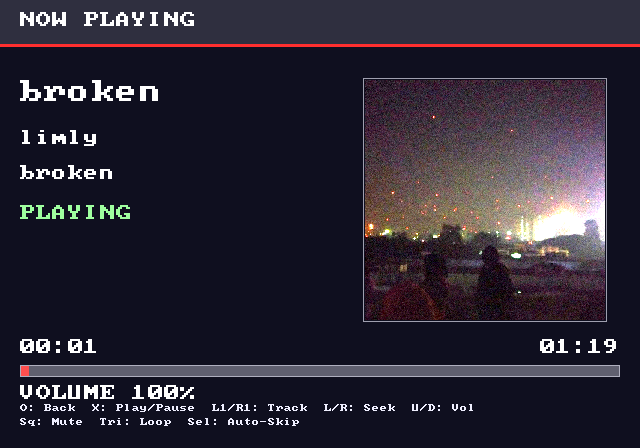
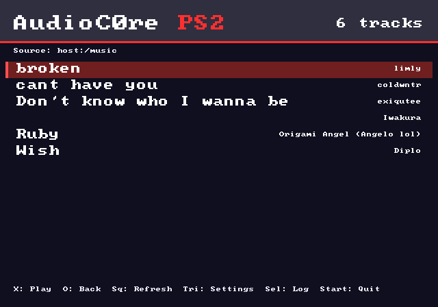
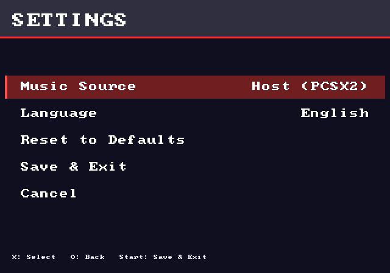
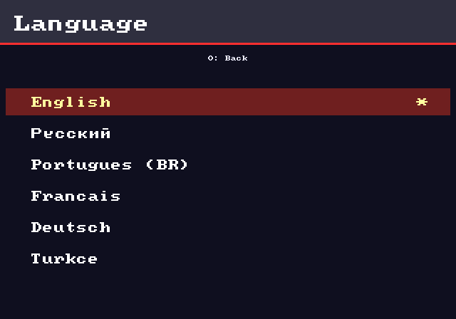
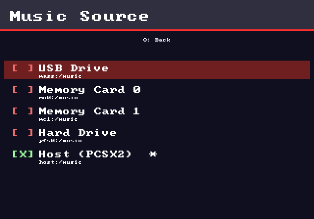

# AudioC0re - PS2

USB music player for PlayStation 2.  
Reads `.mp3` and `.wav` files from `mass:/music/`, displays metadata
(title / artist / album) and embedded cover art — just like the PS4
AudioC0re shell.

**By MexrlDev**

---

## Preview


<hr>
<details>
<summary>See more</summary>

<hr>

<hr>

<hr>

</details>

---

## Folder layout on the USB stick

```
mass:/music/
├── Track 01.mp3
├── Track 02.wav
└── ...
```

If `mass:/music/` doesn't exist, AudioC0re creates it on first launch
and shows a warning on screen asking you to drop files in there.

---

## Controls

### Menu

| Button | Action |
|---|---|
| ↑ / ↓ | Move cursor |
| L1 / R1 | Page up / page down |
| **Square** | Refresh library |
| **Triangle** | Settings |
| **Select** | Toggle debug logging |
| **Cross** | Play selected track |
| **Start** | Quit |

### Player

| Button | Action |
|---|---|
| **Circle** | Back to menu |
| **Cross** | Play / Pause |
| **L1 / R1** | Previous / Next track |
| **Left / Right** | Seek −5s / +5s (tap), −10s / +10s (hold) |
| **Up / Down** | Volume up / down |
| **Square** | Mute / unmute |
| **Triangle** | Loop current track |
| **Select** | Auto-skip on / off |

---

## Features

- **MP3 and WAV playback** — MP3 via minimp3, WAV via built-in parser
- **Full RAM buffering** — no streaming stutter; loads the whole file once
- **Metadata display** — ID3v2.3 / ID3v2.4 / ID3v1 / WAV LIST-INFO
- **Embedded cover art** — APIC frame decoded with stb_image, center-cropped
- **Cyrillic + Latin-1 + Turkish character support** — UTF-8 aware
- **Auto-skip** — chain songs, wrap from last to first
- **Loop** — replay the current track from RAM with zero gap
- **Volume 0–100%** — software mixing, instant response
- **6 languages** — English, Русский, Português (BR), Français, Deutsch, Türkçe
- **Settings menu** — change music source, language, save/reset config
- **Debug logging** — toggle with Select, writes to `<source>/AC-Logs/`
- **USB-removal handling** — never crashes, never hangs, never repeats
- **Runs on PCSX2** — HostFS supported out of the box

---

## Build (GitHub Actions — no local toolchain)

1. Put a **500×500 PNG** at `image/logo.png` (used for the splash screen).
2. Push to `main` — or trigger **workflow_dispatch** in the Actions tab.
3. The `Build AudioC0re - PS2` workflow will:
   - install the PS2SDK container
   - fetch `minimp3.h`, `stb_image.h`, `font8x8_basic.h`
   - convert `image/logo.png` → raw BGRA C source (`source/logo_data.c`)
   - compile, link, and pack
4. Download the artifact **`AUDIOC0RE.ELF`** and drop it on your USB
   stick / memory card. Launch it with wLaunchELF.

---

## Local build (optional)

```bash
export PS2DEV=/usr/local/ps2dev
export PS2SDK=$PS2DEV/ps2sdk
export PATH=$PATH:$PS2DEV/bin:$PS2DEV/ee/bin:$PS2SDK/bin

python3 tools/prepare_assets.py image/logo.png source/logo_data.c

curl -fsSL -o source/minimp3.h         https://raw.githubusercontent.com/lieff/minimp3/master/minimp3.h
curl -fsSL -o source/stb_image.h       https://raw.githubusercontent.com/nothings/stb/master/stb_image.h
curl -fsSL -o source/font8x8_basic.h   https://raw.githubusercontent.com/dhepper/font8x8/master/font8x8_basic.h

cmake -S . -B build -DCMAKE_TOOLCHAIN_FILE=$PS2SDK/ps2dev.cmake
cmake --build build
ps2-packer build/AudioC0re AUDIOC0RE.ELF
```

---

## Project layout

```
.
├── .github/workflows/build.yml
├── CMakeLists.txt
├── README.md
├── LICENSE
├── image/
│   └── logo.png
├── tools/
│   └── prepare_assets.py
└── source/
    ├── main.c
    ├── input.c / input.h
    ├── ui.c / ui.h
    ├── library.c / library.h
    ├── metadata.c / metadata.h
    ├── audio.c / audio.h
    ├── splash.c / splash.h
    ├── menu.c / menu.h
    ├── player.c / player.h
    ├── settings.c / settings.h
    ├── lang.c / lang.h
    ├── config.c / config.h
    ├── log.c / log.h
    ├── font_ext.h
    ├── external_impl.c
    ├── minimp3.h         (fetched by CI)
    ├── stb_image.h       (fetched by CI)
    ├── font8x8_basic.h   (fetched by CI)
    └── logo_data.c       (generated by CI)
```

---

## Third-party software

AudioC0re is built on top of several open-source projects. Each is
listed below with its original license. Full license texts ship with
each project's repository.

| Library | Purpose | License |
|---|---|---|
| [PS2SDK](https://github.com/ps2dev/ps2sdk) | Core PS2 homebrew dev kit: kernel, libc, fileXio, padman, audsrv, libmc, BDM, USB, GS primitives | Academic Free License 2.0 |
| [SDL2 for PS2](https://github.com/ps2dev/SDL) | Video, joystick, and timer backends | zlib License |
| [minimp3](https://github.com/lieff/minimp3) | Single-header MP3 decoder | CC0 1.0 Universal (Public Domain) |
| [stb_image](https://github.com/nothings/stb) | Single-header JPEG / PNG decoder | MIT / Public Domain (dual) |
| [font8x8](https://github.com/dhepper/font8x8) | 8×8 bitmap font used for all UI text | Public Domain |
| [ps2-packer](https://github.com/ps2dev/ps2-packer) | ELF compressor used at build time | zlib License |

The Docker-based local build environment uses the
[ps2dev/ps2dev](https://hub.docker.com/r/ps2dev/ps2dev) image,
maintained by the ps2dev organisation.

---

## License

AudioC0re source code is released under the **MIT License**.  
See [LICENSE](LICENSE) for the full text.
